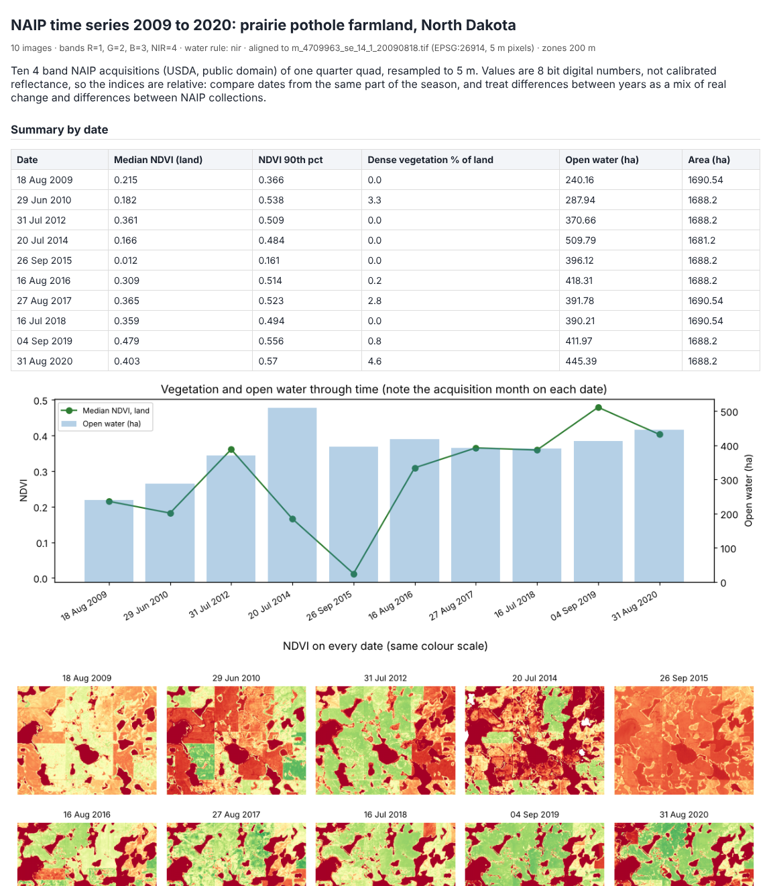
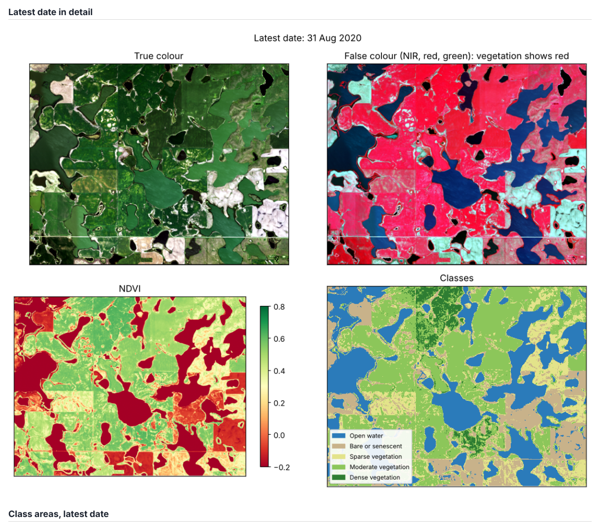

# Multispectral Pipeline

[](https://github.com/jjmmcckk/multispectral-pipeline/actions/workflows/tests.yml)

Turns a stack of multispectral images of the same ground into vegetation and water layers,
a time series, a change map between two dates, management zones and a one page HTML report.
It works the same way on satellite or aerial imagery and on a reflectance orthomosaic from a
multispectral drone camera.



## Process

1. **Choose and credit the data.** The example uses ten 4 band NAIP acquisitions (red, green,
   blue, near infrared) of one quarter quad of prairie pothole farmland in North Dakota, 2009
   to 2020. NAIP is public domain, has a near infrared band and covers the same ground on
   every date, which is what a repeat survey looks like.
2. **Map the bands.** Every sensor orders its bands differently, so the band order is an input
   (`--bands R=1,G=2,B=3,NIR=4`, or `B=1,G=2,R=3,RE=4,NIR=5` for a five band camera), along
   with the value that means 100% (`--scale 255` for 8 bit, `1` for reflectance).
3. **Put every date on one grid.** Each image is warped on the fly to the first date's grid
   (same coordinate system, pixel size and extent), so a pixel means the same piece of ground
   on every date and dates can be subtracted directly.
4. **Process in blocks.** Indices are computed 512 pixels at a time and written straight to
   disk, so memory stays flat whether the input is 10 MB or 10 GB. A test checks that block
   size does not change the result.
5. **Compute the indices** (table below) and write each as a float32 Cloud Optimized GeoTIFF.
6. **Find open water, then classify.** NDVI breaks at 0.2, 0.4 and 0.6 give bare or senescent,
   sparse, moderate and dense vegetation. For water, the textbook rule (NDWI above 0) found
   986 ha on the July 2014 image; checking the pixels showed about 455 ha of it was bright bare
   ground (near infrared around 108 of 255, against about 22 for real water). Water absorbs
   near infrared, so the default now finds a near infrared threshold for each scene (Otsu's
   method) and calls a pixel water when it is darker than that and has NDVI below 0.1: 510 ha.
   On calibrated reflectance, `--water ndwi` uses the textbook rule.
7. **Compare like with like.** Change is NDVI on the later date minus the earlier date, only on
   pixels that are land on both. The example compares two July dates (2014 and 2018), because
   comparing July with September mostly measures the season, not the site.
8. **Summarise for decisions.** The latest date is cut into 200 m zones with median NDVI,
   dense vegetation share and water share, written as GeoJSON for any GIS or web map.

## Indices

| Index | Formula | Used for |
|---|---|---|
| NDVI | (NIR − Red) / (NIR + Red) | Vegetation vigour; drives the classes |
| GNDVI | (NIR − Green) / (NIR + Green) | Vigour in dense canopy, where NDVI saturates |
| NDWI | (Green − NIR) / (Green + NIR) | Open water (McFeeters) |
| NDRE | (NIR − Red edge) / (NIR + Red edge) | Crop stress; added when a red edge band is mapped |
| SAVI | 1.5 (NIR − Red) / (NIR + Red + 0.5) | Vegetation where bare soil shows through |

## Example results (NAIP, 1,688 ha)

| Date | Median NDVI, land | Open water (ha) |
|---|---|---|
| 18 Aug 2009 | 0.22 | 240 |
| 20 Jul 2014 | 0.17 | 510 |
| 26 Sep 2015 | 0.01 | 396 |
| 16 Jul 2018 | 0.36 | 390 |
| 31 Aug 2020 | 0.40 | 445 |

- 2014 has the most open water of the ten dates, which fits a wet year in pothole country.
- 26 Sep 2015 is late season: crops are harvested or senescent, so low NDVI there is timing,
  not crop failure.
- July 2014 to July 2018: mean NDVI change on land +0.19, 740 ha gained more than 0.1, 98 ha
  lost more than 0.1.

**Caveat.** NAIP values are 8 bit digital numbers, not calibrated reflectance, and each year is
a separate collection. Treat differences between years as a mix of real change and
differences between collections; the indices are most reliable for comparing places within one
date. Drone imagery calibrated with a reflectance panel avoids most of this.



The full report is [examples/naip_report/report.html](examples/naip_report/report.html)
(download and open in a browser), with `timeseries.csv`, `zones.geojson` and `summary.json`
beside it.

## Run it

```bash
pip install -e .
bash examples/get_naip.sh            # about 25 MB, saved to examples/data/
cd examples
mspipe data/m_4709963_se_14_1_*.tif --bands R=1,G=2,B=3,NIR=4 --zone 200 \
  --change 20140720 20180716 --out naip_results
```

For a drone reflectance orthomosaic with a red edge band:

```bash
mspipe flight_20240715.tif flight_20240812.tif --bands B=1,G=2,R=3,RE=4,NIR=5 \
  --scale 1 --water ndwi --zone 50 --out field_results
```

Dates are read from `YYYYMMDD` in the file names.

**Outputs:** `rasters/` (one COG per index and date, class rasters, the change raster),
`timeseries.csv`, `zones.geojson`, `summary.json` and `report.html`.

## Tests

`pytest` runs on synthetic images with known answers: NDVI against the formula, results the
same for any block size, a lake of known area found by the scene threshold, a second date on
an offset grid aligned back to the first, a five band reflectance image with red edge, and the
command line end to end. They run in GitHub Actions on Python 3.10 and 3.12.

## Data credit

NAIP imagery: USDA Farm Service Agency, public domain. The ten GeoTIFFs are fetched from the
[opengeos/data](https://github.com/opengeos/data) sample collection.

## Related

- [lidar-web-map](https://github.com/jjmmcckk/lidar-web-map): LiDAR to streamed 3D Tiles, COGs
  and vector tiles in a browser.
- [lidar-qa-toolkit](https://github.com/jjmmcckk/lidar-qa-toolkit): LiDAR acceptance checks
  that can gate a pipeline.

## Author

Jordan McKenzie, Transport Canada Advanced RPAS Pilot and Flight Reviewer, B.Sc. Computer
Science. [LinkedIn](https://www.linkedin.com/in/jordan-mckenzie-gis)

MIT License.
